# ⚡ Siddharth Kumar

**Autonomous Systems & Multi-Agent Robotics Engineer** • Sikkim, India  
`"My code works in simulation. Therefore, the physical universe is currently out of spec."`

 

  

 

---

### 📡 Real-Time Simulation & Signal Telemetry

  <!-- 2D AMR Warehouse Coordination Radar -->
  
  
<strong>Fig 1:</strong> Decentralized AMR Conflict Resolution — ROS 2 Nav2 global costmap inflation halos, differential-drive chassis kinematics, and Space-Time A* trajectory planning with dynamic PIBT yield token handover.

   

  <!-- Acoustic TDOA Spectrum Visualizer -->
  
  
<strong>Fig 2:</strong> EchoLocate Signal Pipeline — Dual-channel acoustic impulse response ($x_0(t)$ vs $x_1(t)$), GCC-PHAT cross-correlation Dirac peak ($\tau = +0.82\text{ms}$), and 4-microphone SRP-PHAT polar beamforming.

---

### 💻 Architecture & Systemd Daemon Status

  <!-- Systemd Service & CLI Benchmark Terminal Window -->
  
  
<strong>Fig 3:</strong> Active <code>systemd</code> daemon lifecycle (<code>siddharth.service</code>) and real-time PIBT multi-agent benchmark execution.

---

### 🕹️ Interactive Dilemma: The 02:00 AM Warehouse Deadlock

  
<b>▶ Start Scenario: Two AMRs meet head-to-head in Aisle 4. The BEL challenge demo is in 5 minutes. What do you do?</b>

   

  

    
<b>[Choice A] Slam the centralized Emergency Stop button</b>

     
    <blockquote>
      ❌ <strong>Outcome:</strong> Every robot in the facility freezes. The warehouse manager gasps. The safety supervisor raises an eyebrow. Task latency drops to zero because tasks are no longer finishing.
        
      <em>Verdict: -500 engineering aura. Try again.</em>
    </blockquote>
  

  

    
<b>[Choice B] Trigger PIBT priority inheritance &amp; Tarjan cycle-breaking</b>

     
    <blockquote>
      ✅ <strong>Outcome:</strong> In 1.2ms, Robot #3 calculates that Robot #7 carries higher task priority. Robot #3 backs smoothly into a designated grid pocket, clears the aisle, and yields the right-of-way. Both robots proceed without a scratch.
        
      <em>Verdict: +10,000 aura. The demo passes with 0 collisions and a 24.89% latency saving. This is why SIH'26 uses decentralized coordination.</em>
    </blockquote>
  

  

    
<b>[Choice C] Blame packet loss and Wi-Fi latency</b>

     
    <blockquote>
      🤷 <strong>Outcome:</strong> The classic systems move. The reviewers nod knowingly because enterprise Wi-Fi is notorious. But since the system runs on a peer-to-peer decentralized mesh with zero central reliance, the excuse fails under cross-examination.
        
      <em>Verdict: Reverting to Choice B is strongly advised.</em>
    </blockquote>
  

---

### 🚀 Projects That Actually Run

<table>
  <tr>
    <td width="50%" valign="top">
      <h4>🤖 <a href="https://github.com/SparkSidd/SIH-26">AMR-Fleet-Coordination</a></h4>
      
Decentralized edge-native AMR warehouse coordination (BEL challenge). Solves multi-agent path conflicts using Space-Time A*, PIBT token negotiation, and Hungarian task allocation.

      
<em>The Reality:</em> 0 collisions across 200 runs. If two robots ever try to occupy the same grid cell, Tarjan's cycle-breaker aggressively intervenes before hardware gets bent.

      

        
        
        
      

      

        <a href="https://sih-26-in4c.onrender.com"><b>▶ Launch Live Digital Twin</b></a> • 
        <a href="https://github.com/SparkSidd/SIH-26"><b>Inspect Codebase</b></a>
      

    </td>
    <td width="50%" valign="top">
      <h4>📡 <a href="https://github.com/SparkSidd/EchoLocate">EchoLocate</a></h4>
      
Research-grade acoustic source localization framework evaluating 3,150 environmental simulation permutations across 4 microphone array geometries.

      
<em>The Reality:</em> Who needs GPS indoors when you can calculate GCC-PHAT TDOA and solve Non-Linear Least Squares multilateration while questioning room reverberation physics.

      

        
        
        
      

      

        <a href="https://github.com/SparkSidd/EchoLocate"><b>▶ Inspect TDOA Pipeline</b></a>
      

    </td>
  </tr>
  <tr>
    <td width="50%" valign="top">
      <h4>🛡️ <a href="https://github.com/SparkSidd/ChainShield">ChainShield</a></h4>
      
Multi-layer supply chain resilience optimization platform utilizing discrete-event simulation and MIP optimization.

      
<em>The Reality:</em> Formulated in Pyomo and solved with HiGHS so supply chain bottlenecks are detected before shipping carriers lose your parcel.

      

        
        
        
      

      

        <a href="https://github.com/SparkSidd/ChainShield"><b>▶ View MIP Formulations</b></a>
      

    </td>
    <td width="50%" valign="top">
      <h4>🥗 <a href="https://github.com/SparkSidd/IngredientInsightAI">IngredientInsightAI</a></h4>
      
Intent-first nutritional intelligence co-pilot built for EnCode 2026 @ IIT Guwahati with multi-tiered LLM reasoning.

      
<em>The Reality:</em> Translates cryptic chemical preservative numbers into plain English warnings so you know why eating ultra-processed chips at 3 AM is suboptimal.

      

        
        
        
      

      

        <a href="https://github.com/SparkSidd/IngredientInsightAI"><b>▶ View EnCode '26 Repo</b></a>
      

    </td>
  </tr>
  <tr>
    <td width="50%" valign="top">
      <h4>🧠 <a href="https://github.com/SparkSidd/MindBridge">MindBridge</a></h4>
      
Full-stack mental health support platform with crisis risk detection, DistilBERT sentiment extraction, and Gemini reasoning.

      
<em>The Reality:</em> Analyzing conversational tokens and stress indicators with sub-second inference latency, fully containerized in Docker so dependency issues can't induce existential dread.

      

        
        
        
      

      

        <a href="https://github.com/SparkSidd/MindBridge"><b>▶ View NLP Architecture</b></a>
      

    </td>
    <td width="50%" valign="top">
      <h4>⚡ <a href="https://github.com/SparkSidd/WebPerfAI">WebPerfAI</a></h4>
      
Full-stack web performance auditing suite integrating Google PageSpeed Insights API, JWT security, and automated Core Web Vitals telemetry.

      
<em>The Reality:</em> Because waiting 4.8 seconds for a JavaScript bundle to hydrate an animated button is a human rights violation.

      

        
        
      

      

        <a href="https://github.com/SparkSidd/WebPerfAI"><b>▶ Audit Telemetry Docs</b></a>
      

    </td>
  </tr>
</table>

---

### 🕹️ Interactive System Diagnostics (Click to Expand)

  
<b>📊 [Empirical Benchmarks] Centralized Greedy vs. Decentralized PIBT &amp; Space-Time A*</b>

   

| Evaluation Parameter | Centralized Greedy Dispatch | Decentralized Fleet Framework (Ours) | Delta / Outcome |
| :--- | :--- | :--- | :--- |
| **Inter-Robot Collisions** | 14 collisions / 200 runs | **0 collisions** | **100% Elimination** |
| **Average Task Completion Latency** | 184.2 seconds | **138.4 seconds** | **-24.89% Faster** |
| **Deadlock Occurrence Frequency** | 18.5% of executions | **0.0% (Tarjan Cycle-Breaking)** | **Complete Deadlock Freedom** |
| **Solver Computation Overhead** | Exponential $O(N!)$ bottleneck | **Polynomial $O(N \log N)$ distributed** | **Sub-50ms Edge Negotiation** |
| **Test Suite Coverage** | N/A | **121 / 121 Tests PASS** | **100% Deterministic Verification** |

  
<b>🚨 [Incident Postmortem] INCIDENT-2026-042: Near-Collision Cycle Resolution</b>

   

> [!WARNING]
> **[03:14:02 UTC]** `AMR_NODE_03` requested reservation lock on grid cell `(X:14, Y:22, T:45)`.  
> **[03:14:02 UTC]** `AMR_NODE_07` currently occupies cell. Potential collision vector detected.  
> **[03:14:03 UTC]** PIBT priority token exchanged. Tarjan cycle resolved in **1.2ms**.  
> **[03:14:04 UTC]** `AMR_NODE_03` redirected via dynamic 4D Space-Time detour. **0 collisions occurred. Hardware intact.**

  
<b>🔴 [System Alert] DO NOT CLICK THIS BUTTON</b>

   

> **CRITICAL ERROR:** You clicked the forbidden button.  
> *Simulation Status:* 100% Nominal.  
> *Collisions:* Still 0.  
> *All 121 Tests:* Still Passing.  
>  
> Since you're curious and thorough: **[⭐ Star the AMR-Fleet-Coordination Repo](https://github.com/SparkSidd/SIH-26)** or email me directly at **[siddharth.sk324@gmail.com](mailto:siddharth.sk324@gmail.com)**.

---

### 🛠️ Honest Tech Stack Opinions

  

| Tool | The Engineering Reality |
| :--- | :--- |
| **Python** | Rapid prototyping when I want the algorithm verified before my coffee cools down. |
| **C++ &amp; ROS 2** | When microsecond latency matters and I crave obscure template linker warnings. |
| **PyTorch &amp; Transformers** | Letting gradient descent make decisions I'm too tired to calculate analytically. |
| **Docker** | "It works on my machine" packaged into an immutable container so it works on yours too. |
| **Linux &amp; systemd** | Because rebooting a server to fix a problem is an admission of moral defeat. |

---

### 📊 Live Telemetry & Verified Evidence

  <!-- TokyoNight Streak Stats Card -->
  
  
    

  <!-- Animated Contribution Snake Eating Contribution Grid -->
  <picture>
    <source media="(prefers-color-scheme: dark)" srcset="https://raw.githubusercontent.com/SparkSidd/SparkSidd/output/github-contribution-grid-snake-dark.svg">
    <source media="(prefers-color-scheme: light)" srcset="https://raw.githubusercontent.com/SparkSidd/SparkSidd/output/github-contribution-grid-snake.svg">
    
  </picture>
  
Automated snake consuming 2,100+ commits so human reviewers don't have to audit them manually.

---

  Formulated with mathematical rigor &amp; questionable sleep schedules by <strong>Siddharth Kumar</strong>. Open for high-impact research, robotics, and distributed systems roles.

