<!-- Custom Bespoke Animated Hero Banner -->

  

<!-- Interactive Quick Links & Status -->

  
  
  
  

---

### 💻 System Telemetry & Architecture Specification

  

---

### 🚀 Highlighted Flagship Engineering Projects

<table width="100%">
  <tr>
    <td width="50%" valign="top">
      <h3>🤖 <a href="https://github.com/SparkSidd/SIH-26">AMR-Fleet-Coordination</a></h3>
      
Decentralized edge-native AMR fleet coordination for smart warehouses (BEL challenge). Features Hungarian task allocation, Space-Time A*, PIBT negotiation, and Tarjan cycle-breaking.

      

        
        
        
      

    </td>
    <td width="50%" valign="top">
      <h3>📡 <a href="https://github.com/SparkSidd/EchoLocate">EchoLocate</a></h3>
      
Research-grade acoustic source localization framework evaluating 3,150 grid runs across 4 microphone geometries with GCC-PHAT TDOA and NLS multilateration.

      

        
        
        
      

    </td>
  </tr>
  <tr>
    <td width="50%" valign="top">
      <h3>🛡️ <a href="https://github.com/SparkSidd/ChainShield">ChainShield</a></h3>
      
Multi-layer supply chain resilience optimization platform utilizing discrete-event simulation, MIP optimization (HiGHS), and cascade vulnerability mapping.

      

        
        
        
      

    </td>
    <td width="50%" valign="top">
      <h3>🥗 <a href="https://github.com/SparkSidd/IngredientInsightAI">IngredientInsightAI</a></h3>
      
AI-native nutritional co-pilot built for EnCode 2026 @ IIT Guwahati. Replaces passive data tables with dynamic intent inference and uncertainty calibration.

      

        
        
        
      

    </td>
  </tr>
  <tr>
    <td width="50%" valign="top">
      <h3>🧠 <a href="https://github.com/SparkSidd/MindBridge">MindBridge</a></h3>
      
Full-stack mental health support platform with crisis risk detection, DistilBERT + VADER sentiment analysis, and Gemini LLM reasoning.

      

        
        
        
      

    </td>
    <td width="50%" valign="top">
      <h3>⚡ <a href="https://github.com/SparkSidd/WebPerfAI">WebPerfAI</a></h3>
      
Full-stack web performance auditing suite integrating Google PageSpeed Insights API, JWT security, and automated Core Web Vitals telemetry.

      

        
        
      

    </td>
  </tr>
</table>

---

### 🛠️ Core Engineering Stack

| Domain | Core Frameworks, Libraries & Tooling |
| :--- | :--- |
| **Robotics & Spatial Computing** | `ROS 2`, `Gazebo Harmonic`, `Webots R2023b`, `PyRoomAcoustics`, `SimPy` |
| **Algorithms & Mathematical Optimization** | `Pyomo`, `HiGHS Solver`, `NetworkX`, `Hungarian Matching`, `Space-Time A*`, `PIBT` |
| **AI, Neural Models & Signal Processing** | `PyTorch`, `HuggingFace Transformers`, `DistilBERT`, `Gemini API`, `scikit-learn`, `NumPy`, `SciPy` |
| **Distributed Systems & Full-Stack** | `FastAPI (Async)`, `React 18`, `Next.js 14`, `TypeScript`, `Node.js`, `Vite`, `Tailwind CSS` |
| **Data Architecture & Infrastructure** | `PostgreSQL`, `MongoDB`, `SQLite`, `Docker`, `Docker Compose`, `Nginx`, `Linux`, `Git` |

 

  

---

### 📊 Live Activity & Analytics Radar

  <!-- TokyoNight Streak Stats Card -->
  

 

<!-- Animated Contribution Snake Eating Contribution Grid -->

  <picture>
    <source media="(prefers-color-scheme: dark)" srcset="https://raw.githubusercontent.com/SparkSidd/SparkSidd/output/github-contribution-grid-snake-dark.svg">
    <source media="(prefers-color-scheme: light)" srcset="https://raw.githubusercontent.com/SparkSidd/SparkSidd/output/github-contribution-grid-snake.svg">
    
  </picture>

---

  
Engineered with mathematical rigor &amp; empirical benchmarks by <strong>Siddharth Kumar</strong>. Open for high-impact research, robotics, and distributed systems collaborations.

  

